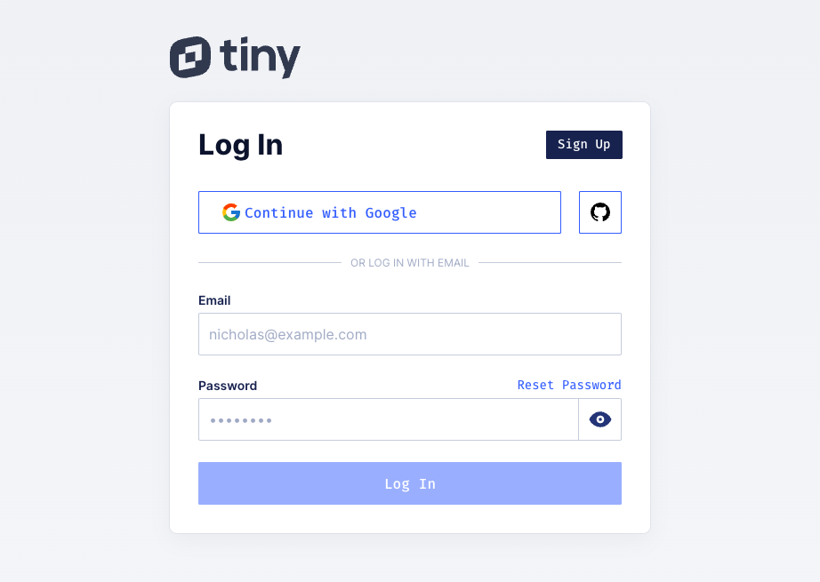
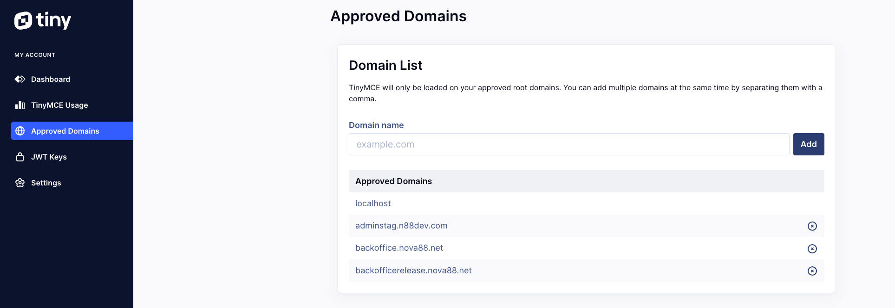

# TinyMCE React 快速入門

1. 閱讀快速入門指南
   閱讀 TinyMCE React 快速入門指南 概述如何使用 TinyMCE Cloud 在 React 上設定 TinyMCE。

2. 新增 TinyMCE 程式碼片段

下面的程式碼片段包含唯一的 API 金鑰以及您在 TinyMCE 計畫中有權使用的插件。

將程式碼片段複製到 src/App.js 檔案中，並根據需求進行修改：

```tsx
import React from 'react'
import { Editor } from '@tinymce/tinymce-react'

const apiKey = 't5p5ncr6w0s02o5ifaxsqnufe6wambqqdatm06mezmfuxeth' // 範例金鑰

export default function App() {
	return (
		<Editor
			apiKey={apiKey}
			init={{
				plugins:
					'anchor autolink charmap codesample emoticons image link lists media searchreplace table visualblocks wordcount',
				toolbar:
					'undo redo | blocks fontfamily fontsize | bold italic underline strikethrough | link image media table | align lineheight | numlist bullist indent outdent | emoticons charmap | removeformat',
			}}
			initialValue='Welcome to TinyMCE!'
		/>
	)
}
```

3. 金鑰與 domain 配置

登入 [tiny 雲端後台](https://www.tiny.cloud/auth/login/?redirect_to=%2Fmy-account%2Fintegrate%2F)

> 使用 ailabpte@gmail.com 註冊金鑰
> 

登入後就可以看到 金鑰與 domain 配置

> 金鑰，Dashboard 可以看到此帳號所申請的金鑰
> 

> 有使用到編輯器的線上環境需要將 domain 加入白名單
> 

REFERENCE:

- [TinyMCE Cloud](https://www.tiny.cloud/docs/tinymce/6/cloud-troubleshooting/#this-domain-is-not-registered-with-tiny-cloud-please-see-the-quick-start-guide-or-create-an-account)
- 編輯器有狀況時可參考 [tiny 雲端故障排除](https://www.tiny.cloud/docs/tinymce/6/cloud-troubleshooting/#this-domain-is-not-registered-with-tiny-cloud-please-see-the-quick-start-guide-or-create-an-account)
