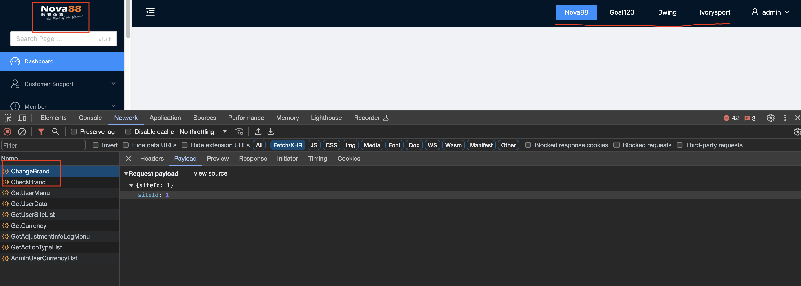
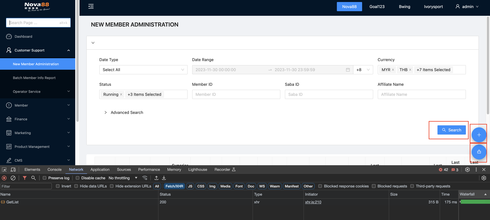
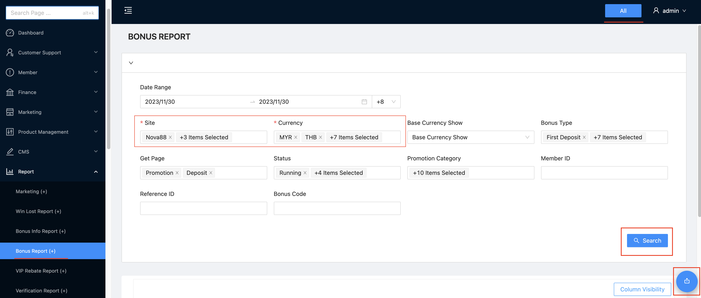
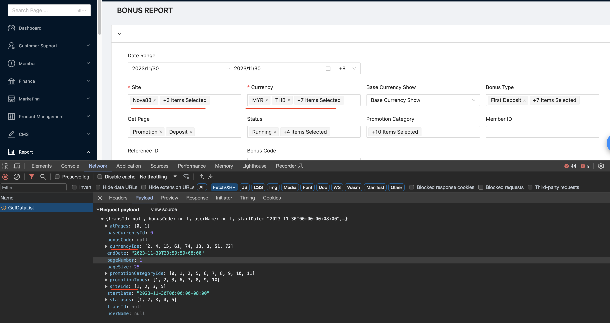

# 單一品牌與多品牌模式

## 單一品牌模式

> 當頁面的 allSiteMode = false 時，渲染方式及操作方式就會是 **單一品牌模式**

- 畫面右上角出現目前品牌的狀態
- 畫面左上角出現目前品牌的 Logo
- 點擊右上角切換品牌時， fetch ChangeBrand (將 siteId 序列化並存在 cookie) 、 CheckBrand (透過 api 切換 cookie 並且 response 存在 redux) 來切換品牌
- 頁面上的 action (搜尋、新增、修改、刪除、導出 e.g) 的各種操作的 siteId payload 會以兩種方式跟後端溝通
  1. fetch 時後端直接拿 cookie 裡的 siteId ，此種 api 前端則不用特別帶 siteId 到 payload 裏
  2. fetch 時由前端拿 redux 裏面的 siteId 經由 payload 一起送出





## 多品牌模式

> 當頁面的 allSiteMode = false 時，渲染方式及操作方式就會是 **多品牌模式**

- 畫面右上角出現 All 的按鈕
- 畫面左上角品牌 Logo 隱藏
- 由內頁的 **Site** 與 **Currency** 下拉選單決定要撈取哪些品牌的哪些幣別
- 頁面上的 action (搜尋、新增、修改、刪除、導出 e.g) 的各種操作 **只透過 payload 與後端溝通**
- 頁面將 Site 下拉選單挪進來之後，要顯示為多選或單選，以 pm 與 市場當前的討論為主
- api 的 品牌與幣別約定
  目前後端支援三種送出品牌與幣別的方式，並且透過優先權為：

```
1. multiSiteAndCurrencyIds => 前端不使用，統一使用 2. 或 3.
2. CurrencyIds, SiteIds
3. CurrencyId, SiteId

SiteId:int
SiteIds:int[]
CurrencyId:int
CurrencyIds:int[]
```

範例，單選及複選端看頁面的規劃混合使用，後端都會再格式化成他們要的最終格式

```tsx
// 可以帶 siteIds (複選) + currencyId (單選)
const payload1 = {
  siteIds: [1, 2]
  currencyId: 2
}
// 可以帶 siteIds (單選) + currencyId (複選)
const payload = {
  siteId: 1
  currencyIds: [2, 15]
}
// 可以帶 siteIds (複選) + currencyId (複選)
const payload = {
  siteIds: [1, 2]
  currencyIds: [2, 15]
}
```



api 範例

